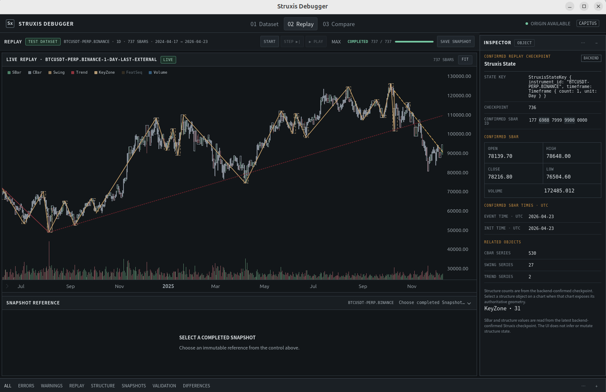

# Struxis Debugger

Struxis Debugger is a desktop application for inspecting, visualizing, and replaying market-structure processing in **Struxis**, built with **Rust**, **Tauri 2**, **Vue 3**, and **Bun**.

The application brings market data, derived structures, replay state, and diagnostic information into an interactive charting workspace. It is intended for developing, verifying, and troubleshooting Struxis behavior—not for live order execution.

> **Repository status:** Struxis Debugger has its own public Git repository, but its Rust package currently depends on crates and dependency declarations in the private Capitus Cargo workspace. The public repository is **not yet a standalone Rust build**. See [Build and dependency model](#build-and-dependency-model).

## What it provides

- **Market-structure visualization:** inspect the SBar, CBar, Swing, and Trend layers and their relationships.
- **Replay and inspection:** step through processing and inspect structure state at replay positions.
- **Snapshots:** save and restore replay/inspection state for debugging workflows.
- **Chart drawing tools:** annotate charts with lines and shapes while analyzing structure behavior.
- **Desktop diagnostics:** inspect application state through the Tauri desktop interface.

Some features require local market data and Capitus/Struxis integration. Availability depends on the checked-out project revision and test data.

## Technology

| Layer | Technology |
| --- | --- |
| Desktop application | Tauri 2 |
| Backend and domain integration | Rust |
| Frontend | Vue 3, TypeScript, Vite |
| Charts | Lightweight Charts |
| Frontend package manager | Bun 1.4.3 |
| Frontend tests | Vitest, Playwright |

## Replay preview



## Repository layout

```text
struxis-debugger/
├── src/                 # Rust application, replay and diagnostic integration
├── frontend/            # Vue frontend and browser E2E tests
├── desktop-e2e/         # Desktop E2E test harness
├── Cargo.toml           # Rust crate (Capitus workspace dependencies)
├── package.json         # Root-level frontend command wrappers
├── tauri.conf.json      # Tauri desktop configuration
└── README.md
```

The application owns its desktop UI, IPC interactions, replay worker lifecycle, and snapshot storage. It does not require `capitus-terminal` or `capitus-node` as application entry points.

## Build and dependency model

The source of truth is this public repository. In the Capitus development environment, it is used at:

```text
capitus/
└── crates/
    ├── struxis/
    ├── strategy/
    └── struxis-debugger/    # Git submodule → this public repository
```

This is **one source repository**, not two synchronized copies. Capitus records a specific submodule commit. Updates to this project are committed and pushed from `struxis-debugger`, then the submodule pointer is updated in Capitus.

**Current limitation:** `Cargo.toml` uses `workspace = true` dependencies (including `capitus-struxis`, `capitus-strategy`, and NautilusTrader crates), plus workspace lint settings. Consequently, cloning this public repository alone does not provide the complete Rust build graph. A standalone build will require an explicit dependency and workspace configuration change; no such capability is claimed here.

## Prerequisites

For development inside the Capitus workspace:

- Rust toolchain supporting **edition 2024** and the workspace's pinned dependencies.
- **Bun 1.4.3**, as declared in `package.json`.
- **Tauri 2 CLI** (`cargo tauri`) and the platform's Tauri 2 system prerequisites.
- Access to the Capitus Cargo workspace and its dependencies.

On Linux, follow the [Tauri 2 prerequisites](https://v2.tauri.app/start/prerequisites/) for required WebKit/GTK development packages. These system dependencies do not need reinstalling when the Git repository is reorganized.

## Development

### 1. Prepare the workspace

If you are using the Capitus repository, initialize the submodule:

```bash
git submodule update --init --recursive
```

From the **Capitus repository root**, go to the project:

```bash
cd crates/struxis-debugger
```

### 2. Install frontend dependencies

```bash
cd frontend
bun install --frozen-lockfile
cd ..
```

This restores project-local dependencies from `frontend/bun.lock`; it does not reinstall Bun itself.

### 3. Start the desktop application

```bash
cargo tauri dev
```

`tauri.conf.json` automatically runs the frontend development command before launching Tauri. There is normally no need to start Vite in a second terminal. The Vite development server uses **http://localhost:1421**.

For frontend-only work (without the desktop shell):

```bash
bun run dev
```

Run these commands from the `struxis-debugger` project root unless stated otherwise. The root `package.json` forwards frontend scripts to `frontend/`.

## Validation

From the **Capitus workspace root**:

```bash
cargo check -p capitus-struxis-debugger
cargo test -p capitus-struxis-debugger
```

From the **struxis-debugger project root**:

```bash
bun run check
bun run test:e2e
bun run test:e2e:desktop
```

- `bun run check` runs frontend unit tests, TypeScript type checking, and a production frontend build.
- `bun run test:e2e` runs the browser end-to-end suite and may require Playwright browser installation.
- `bun run test:e2e:desktop` uses the separate desktop E2E harness; additional local desktop test prerequisites may apply.

These are available commands, **not a claim that all tests currently pass**.

## Using the debugger

The primary workflow is to load or prepare a market-data replay, navigate the chart, inspect structures and their lifecycle, and compare the observed result against the expected Struxis domain behavior. Drawing tools can annotate key locations without changing the underlying structure calculations. Replay snapshots support returning to captured states during debugging.

For UI diagnostics, right-click in the Debugger window and select **复制文档 HTML** to copy the rendered document markup. The copied markup excludes the context menu itself.

## Design boundaries

- **Struxis** owns market-structure semantics and calculations.
- **Struxis Debugger** owns visualization, replay controls, inspection, snapshots, and desktop interaction.
- **NautilusTrader and Capitus dependencies** supply the relevant integration and data model in the current workspace.
- The debugger is a diagnostic and development tool, not a separate trading execution engine.

Detailed implementation behavior should be checked against the source and tests. Architecture documents previously referenced under `capitus/docs/architecture/struxis/` are not included in this repository by those old relative paths; do not treat the former README links as valid public documentation.

## Contributing and development workflow

When working from the Capitus checkout, commit changes **inside the submodule first**:

```bash
cd crates/struxis-debugger
git add .
git commit -m "docs: update debugger documentation"
git push origin main
```

Then update the pinned submodule commit in the parent repository:

```bash
cd ../..
git add crates/struxis-debugger
git commit -m "chore: update struxis-debugger submodule"
```

The public repo and the private parent repo have separate Git histories. The parent repository tracks the exact public commit used by Capitus.

## Project status

This README describes the current repository integration and developer entry points. Independent installation and compilation from a fresh public-only clone remain future work until its workspace-based Rust dependencies are decoupled or published.
